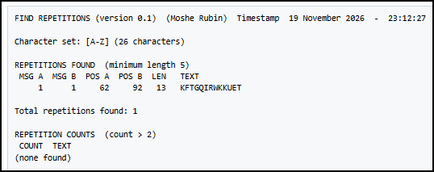
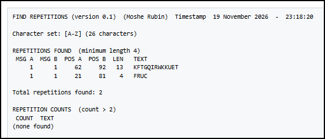

[&larr; back to the guide](find-repetitions-guide.html#examples-of-finding-repetitions)

## The ciphertext

The ciphertext we will examine is a Vigenère with a key of five letters:

```
VYCTG GDWLB NCYIM CTIPM FRUCY TFKIA GEMGM JIGSZ GJCCW TVGCY
QIATF GERHM QKFTG QIRWK KUETU GWMGX FRUCT PUFDE FKFTG QIRWK
KUETT VRJAV QJRH
```

## Step by step

Open a clean copy of Find Repetitions and paste in the ciphertext:

\

Set the other fields if necessary and click "Run".

The result is shown at the bottom of the window:

\

With the default minimum length of 5, the tool finds one repetition:

```
REPETITIONS FOUND  (minimum length 5)
 MSG A  MSG B  POS A  POS B  LEN   TEXT
     1      1     62     92   13   KFTGQIRWKKUET
```

A thirteen-letter repetition is not an accident. Its interval is 92 − 62 = 30.

Let's lower the minimum length to 4 and rerun:

\

Clicking "Run" gives us all repetition of four or more letters:

\

Lowering the minimum length to 4 and rerunning adds a second one:

```
     1      1     21     81    4   FRUC
```

Its interval is 81 − 21 = 60. The factors the two intervals share are 2, 3, 5,
6, 10, 15 and 30, so the period is one of these. Trying the smallest likely
values first, a period of 5 turns out to be correct.

The plaintext contains the phrase *THE NORTH RIDGE* three times, but only two
of its occurrences produce a repetition. The first two lie 33 letters apart,
which is not a multiple of 5, so they were enciphered by different parts of
the key and come out different. This is why the intervals of genuine
repetitions share the period as a factor.
