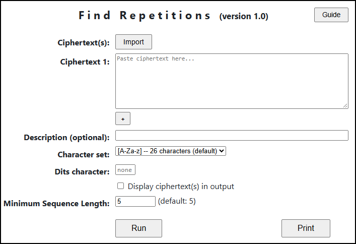

[&larr; back to the guide](find-repetitions-guide.html#examples-of-finding-repetitions)

## The ciphertext

The ciphertext we will examine is a Vigenère:

```
VYCTG GDWLB NCYIM CTIPM FRUCY TFKIA GEMGM JIGSZ GJCCW TVGCY
QIATF GERHM QKFTG QIRWK KUETU GWMGX FRUCT PUFDE FKFTG QIRWK
KUETT VRJAV QJRH
```

## Step by step

Open a clean copy of Find Repetitions and paste in the ciphertext:

\

Leave the other settings as they are and click **Run**.

The result is shown at the bottom of the window:

\

With the default minimum length of 5, the tool finds one repetition:

```
REPETITIONS FOUND  (minimum length 5)
 MSG A  MSG B  POS A  POS B  LEN   DIST   TEXT
     1      1     62     92   13     30   KFTGQIRWKKUET
```

A 13-letter repetition is not an accident. Its interval, shown under DIST,
is 30.

To get shorter repetitions, lower the minimum length to 4:

\

Click **Run** to find every repetition of four or more letters:

\

This adds a second repetition:

```
 MSG A  MSG B  POS A  POS B  LEN   DIST   TEXT
 ...
     1      1     21     81    4     60   FRUC
```

Its interval is 60. The factors that 30 and 60 share are 2, 3, 5, 6, 10, 15 and
30, so the period is one of these. A period of 2 or 3 would make a very weak
cipher, so try 5 first. The plaintext below shows that 5 is correct.

Here is the plaintext, in rows of five letters beneath the key `CRYPT`. Each row
is one pass through the key, so each column was enciphered with a single key
letter:

```
CRYPT
-----
THEEN
EMYWI
LLATT
ACKAT
DAWNF
ROMTH
ENORT
HRIDG
ESEND
REINF
ORCEM
ENTST
OTHEN
ORTHR
IDGEB
EFORE
DAWNA
NDHOL
DTHEN
ORTHR
IDGEA
TALLC
OSTS
```

The plaintext contains the phrase *THE NORTH RIDGE* three times, but only the
last two, 30 letters apart, produce a repetition. The first two lie 33 letters
apart, which is not a multiple of 5, so they were enciphered by different parts
of the key and come out different. This is why the intervals of genuine
repetitions share the period as a factor.