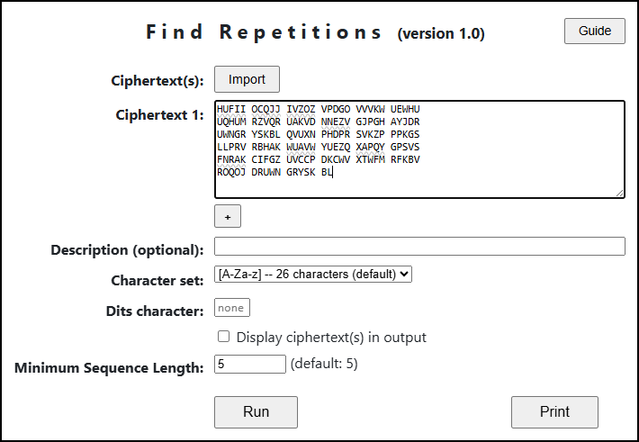
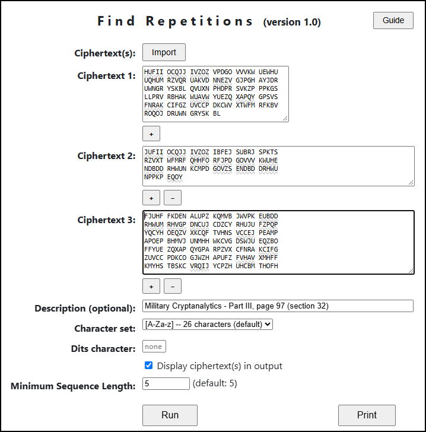
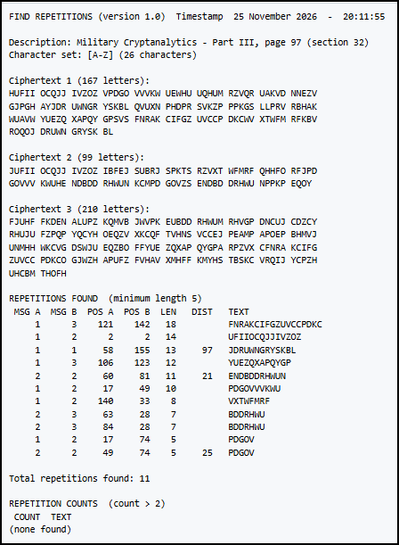
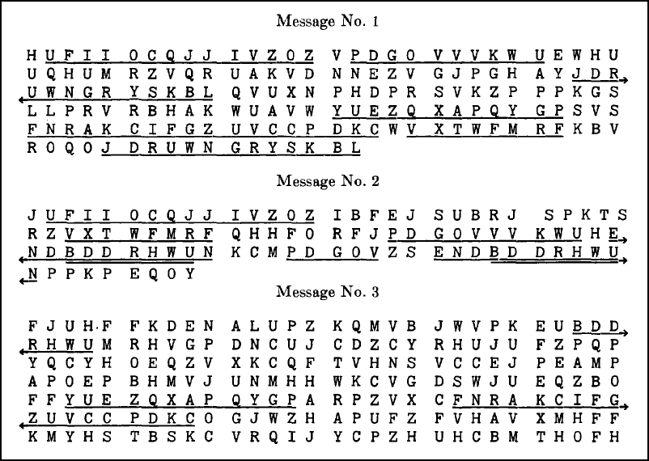

[&larr; back to the guide](find-repetitions-guide.html#examples-of-finding-repetitions)

In this example we will see how to enter multiple ciphertexts, searching for
repetitions between all of them (and within each message).

## The ciphertexts

The following three messages are taken from *Military Cryptanalytics, Part III*,
page 97 (section 32):

```
HUFII OCQJJ IVZOZ VPDGO VVVKW UEWHU
UQHUM RZVQR UAKVD NNEZV GJPGH AYJDR
UWNGR YSKBL QVUXN PHDPR SVKZP PPKGS
LLPRV RBHAK WUAVW YUEZQ XAPQY GPSVS
FNRAK CIFGZ UVCCP DKCWV XTWFM RFKBV
ROQOJ DRUWN GRYSK BL

JUFII OCQJJ IVZOZ IBFEJ SUBRJ SPKTS
RZVXT WFMRF QHHFO RFJPD GOVVV KWUHE
NDBDD RHWUN KCMPD GOVZS ENDBD DRHWU
NPPKP EQOY

FJUHF FKDEN ALUPZ KQMVB JWVPK EUBDD
RHWUM RHVGP DNCUJ CDZCY RHUJU FZPQP
YQCYH OEQZV XKCQF TVHNS VCCEJ PEAMP
APOEP BHMVJ UNMHH WKCVG DSWJU EQZBO
FFYUE ZQXAP QYGPA RPZVX CFNRA KCIFG
ZUVCC PDKCO GJWZH APUFZ FVHAV XMHFF
KMYHS TBSKC VRQIJ YCPZH UHCBM THOFH
```

## Step by step

We begin by copying the first ciphertext into the input box labeled
**Ciphertext 1**:

\

To add the second ciphertext, click **+** under the first box and paste it in.
Do the same for the third, enter a description, and check
**Display ciphertext(s) in output**. The page now looks like this:

\

Click **Run** to execute the search.

## What the search results show

\

These results are identical to the ones shown in *Military Cryptanalytics* (see
the underlined repetitions):

\

The 13-letter repetition `JDRUWNGRYSKBL` within message 1 and the 10-letter
`PDGOVVVKWU` shared by messages 1 and 2 are the ones the book studies.

The three repetitions within a single message have DIST values of 97, 21 and
25, which share no common factor. In
[example 1](example-1-single-ciphertext-manually-inserted.html#step-by-step)
the intervals 30 and 60 pointed to a period of 5. Here they do not, which
argues against a simple repeating key. This is one of the reasons Callimahos
considers a plaintext autokey system possible (Part III, section 32).

For what repetitions between messages can tell you, see
[Uses of repetitions between messages](find-repetitions-guide.html#uses-of-repetitions-between-messages).

## References

- Callimahos, Lambros D. *Military Cryptanalytics, Part III*.
  Fort George G. Meade, MD: National Security Agency, 1977.
  Released 2020.
  ([Available online](https://www.governmentattic.org/41docs/NSAmilitaryCryptalyticsPt3_1977.pdf))
  - See section 32 (pp. 97 ff.) for a discussion of analyzing the ciphertexts
    on this page.