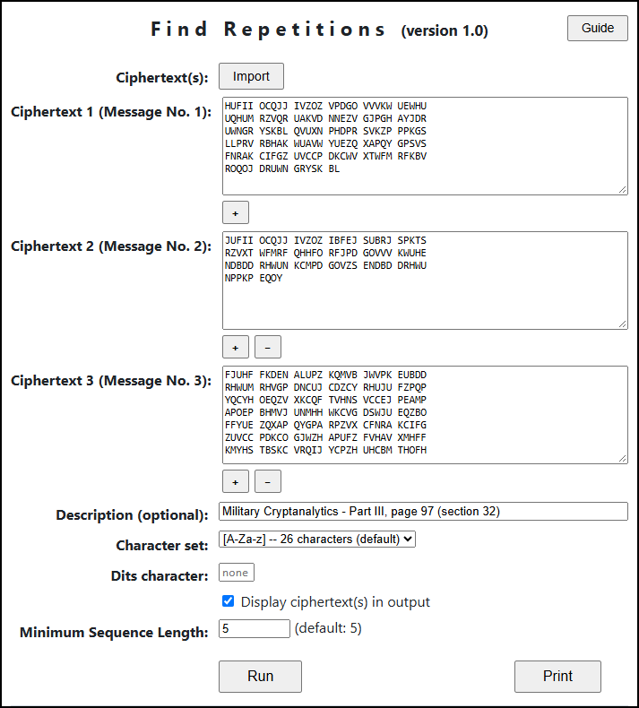
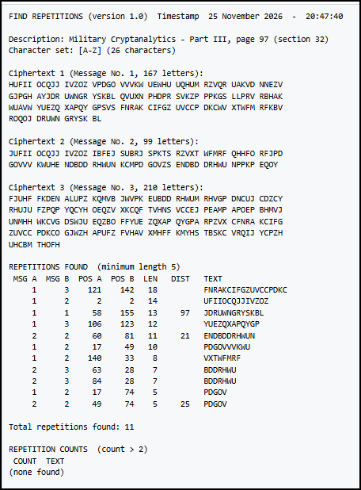

[&larr; back to the guide](find-repetitions-guide.html#examples-of-finding-repetitions)

This example is very similar to
[example 2](example-2-multiple-ciphertexts-manually-inserted.html). The only
difference is that the ciphertexts are imported from a file rather than pasted
in one at a time.

## The ciphertexts

For this example, we will use the same three ciphertexts as in example 2. We
will first create a text file containing all three ciphertexts. The format is as
follows:

* Ciphertexts are separated from each other with a blank line.
* There should be **no** blank lines within a single ciphertext.
* You may put any number of comment lines before a ciphertext; each starts with
  `#`.
* The last comment before a ciphertext becomes its name in the report. Earlier
  comments, such as the Source line, are ignored.

Here are the three ciphertexts as saved in a text file:

```
# Source: Military Cryptanalytics, Part III, page 97 (section 32)
# Message No. 1
HUFII OCQJJ IVZOZ VPDGO VVVKW UEWHU
UQHUM RZVQR UAKVD NNEZV GJPGH AYJDR
UWNGR YSKBL QVUXN PHDPR SVKZP PPKGS
LLPRV RBHAK WUAVW YUEZQ XAPQY GPSVS
FNRAK CIFGZ UVCCP DKCWV XTWFM RFKBV
ROQOJ DRUWN GRYSK BL

# Message No. 2
JUFII OCQJJ IVZOZ IBFEJ SUBRJ SPKTS
RZVXT WFMRF QHHFO RFJPD GOVVV KWUHE
NDBDD RHWUN KCMPD GOVZS ENDBD DRHWU
NPPKP EQOY

# Message No. 3
FJUHF FKDEN ALUPZ KQMVB JWVPK EUBDD
RHWUM RHVGP DNCUJ CDZCY RHUJU FZPQP
YQCYH OEQZV XKCQF TVHNS VCCEJ PEAMP
APOEP BHMVJ UNMHH WKCVG DSWJU EQZBO
FFYUE ZQXAP QYGPA RPZVX CFNRA KCIFG
ZUVCC PDKCO GJWZH APUFZ FVHAV XMHFF
KMYHS TBSKC VRQIJ YCPZH UHCBM THOFH
```

## Step by step

To import the three messages, click the **Import** button and load your text
file. Adding a description and checking **Display ciphertext(s) in output**
should give you the following:

\

All that remains is to click **Run**.

All other steps are identical to example 2, and the results are the same:

\

In the report, each ciphertext is headed with its name, for example
`Ciphertext 1 (Message No. 1, 167 letters)`.