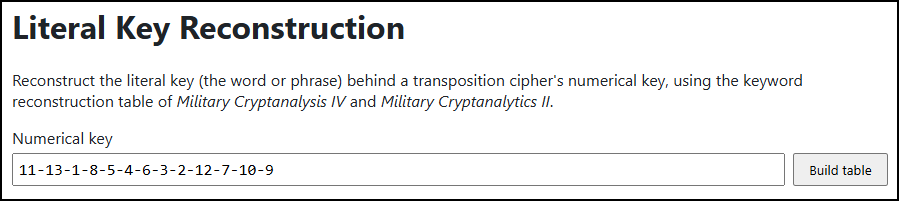
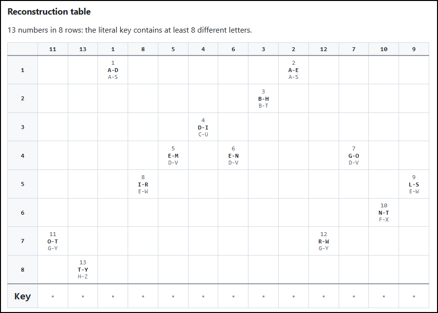
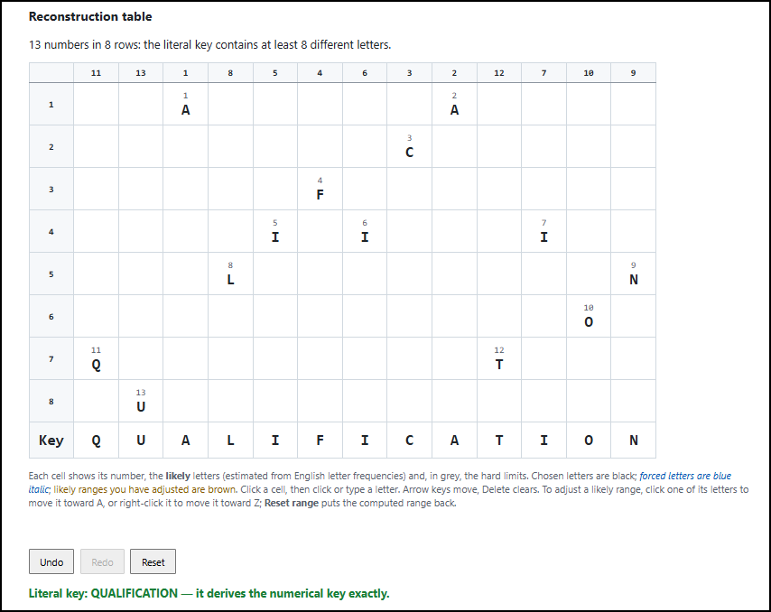

[&larr; back to the guide](literal-key-reconstruction-guide.html#examples)

## The numerical key

In this example we reconstruct the literal key behind the numerical key "11-13-1-8-5-4-6-3-2-12-7-10-9".  As a first step, we will assume the literal key is a single English word.  Here is our plan:

* Using a word list, we'll search for a single word that matches our numerical key.
* If we don't find the literal key:
    * Search again with a larger word list.
    * If we still don't find it, assume the key consists of two or more words.

## Step by step

Begin by typing or pasting the numerical key into the "Numerical key" text field:

\

Click the "Build table" button to initialize the tool with your numerical key.  You can see that the reconstruction table has been set up for you:

\

Next, scroll past the reconstruction table to the "Word list matching" section:

\

Search for a one-word solution to our numerical key.  First, select a word list file (the [guide](literal-key-reconstruction-guide.html#word-lists) provides links to English word lists).  The word list selected here is Google's 20,000 most common words, against about 370,000 in the dwyl list:

\

(Loading a new word list file, or modifying any field, automatically restarts the search.)

Set the matching filter:

* Positions 1 to 13 already cover the whole key, which you want to match, so leave them alone.
* The word range of 1 to 1 means you're looking for a single word that solves the numerical key.
* Leave the default value for minimum number of letters.  With one word specified, this value will only trim the "Longest words" results.
    * When the key may contain several words, the smaller the minimum word length, the more time the tool needs to run.  If you think the smallest word in the key may be three letters (e.g., "the", "and"), then set the minimum value to three (3).  If you believe the single-letter words "A" or "I" may have been used in the literal key, you will need to specify a value of one (1). That slows the search, but may be needed to find the correct solution.
    * The one- and two-letter limits are left blank, and the A-and-I box stays ticked.

\

After a moment, you can see the results:

\

::: indented
<b>Note:</b> This screenshot shows proper names, brand names and abbreviations, such as PUBMED, SONOMA, XHTML, COHEN. Frequency lists built from web text include them. You should be aware of such noise when using public word lists.
:::

### Results: Longest words that fit anywhere

This list helps most when the literal key has several words: even when no phrase fills the whole key, a long word from this list may be one of its words.

Here QUALIFICATION is the only word that fills all 13 of the positions.

::: indented
<b>Note:</b> QUALIFIED 1-9 and MEDICATION 4-13 both fit the key but are wrong. Fitting part of the key doesn't make a word correct.
:::

### Results: Words and phrases filling the positions

In this section, the matcher found exactly one word: QUALIFICATION.  Clicking on that word in the results sets up the reconstruction table with the solution:

\

The reconstruction table states clearly "Literal key: QUALIFICATION — it derives the numerical key exactly".

## Summary

In this simple example, after providing a smaller word list, we specified in the matching filter that we're looking for a single word that matches the numerical key.  If we had failed to find the key, we would either:

* Assume we need a larger word list.
* Assume the literal key consists of multiple words (see [example 2](example-2-matching-multi-word-key.html) for such an approach).