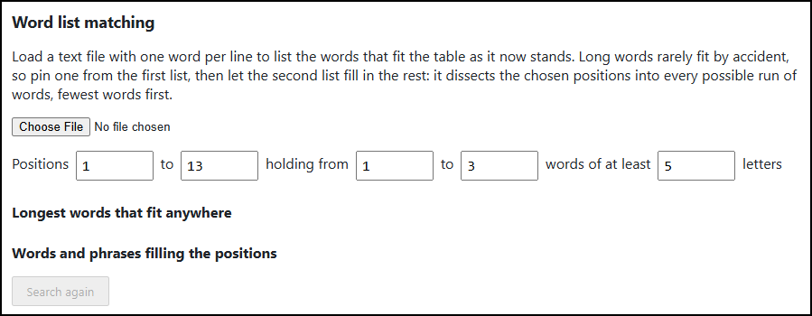
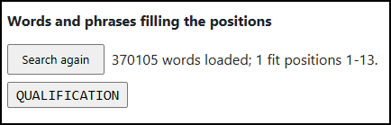

[&larr; back to the guide](literal-key-reconstruction-guide.html#examples)

## The numerical key

Our example will use the numerical key "11-13-1-8-5-4-6-3-2-12-7-10-9", trying to reconstruct the original literal key.  As a first step, we will assume the literal key is a single English word.  Here is our plan:

* Using a word list, we'll search for a single word that matches our numerical key.
* Should we fail to find the literal key, we will search again with a larger word list.
* If we still fail to find the key, we should assume the key consists of two or more words.

## Step by step

We begin by pasting the numerical key into the "Numerical key" text field:

Click the "Build table" button to initialize the tool with your numerical key.  You can see that the reconstruction table has been set up for you:

As a first step, we will scroll past the reconstruction table to the "Word list matching" section:

Let's search for a one-word solution to our numerical key.  First, we select a word list file (the parent guide file provide links to English word lists):

Now we want to tell the tool the range of words we are looking for in the literal key.  In addition, we specify the minimum number of letters a word can have.

::: indented
The smaller the minimal letter value, the more time the tool needs to run.  If you think the smallest word in the key can be three letters (e.g., "the", "and"), then set the minimum value to three (3).  If you believe the word "a" or "i" may have been used in the literal key, you will need to specify a value of one (1).
:::

In our case, we will specify that we are looking for a single word.  In this case the minimum word size value should be the number of values in the numerical key:

After a moment, you can see the result:

## Post mortem

In this simple example, after providing a good word list, we specified in the matching filter that we're looking for a single word that matches the numerical key.  Fortunately, we did not have to use a larger word list, or assume multiple words in the literal key.