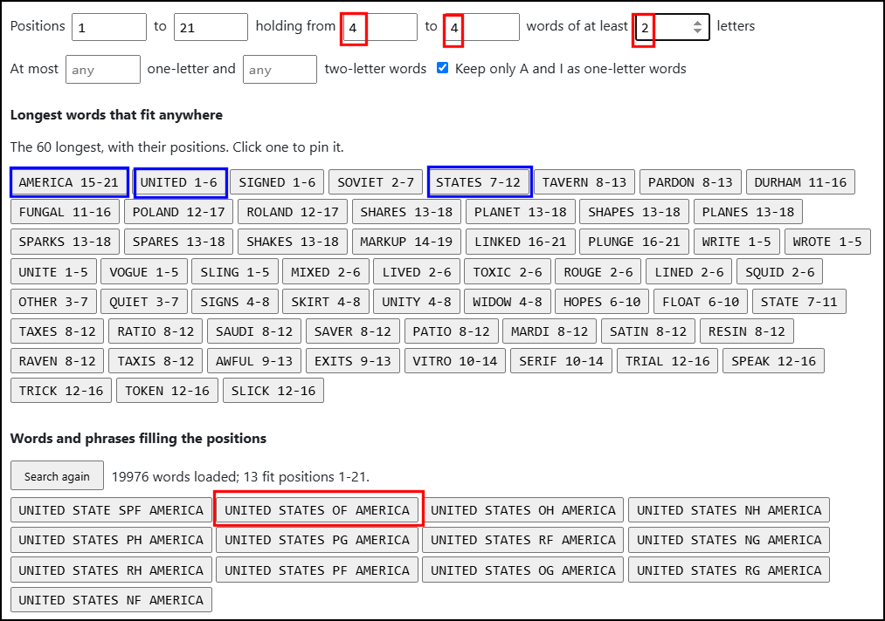

[&larr; back to the guide](literal-key-reconstruction-guide.html#examples)

## The numerical key

Our example is taken from *Military Cryptanalytics*, Part III, page 307:

\

Although the example is a transposition matrix containing blanks, we are 
interested in the numerical key on top of the matrix:

```
21 13 10 18 6 5 16 19 1 20 7 17 14 9 2 12 8 15 11 4 3
```

::: indented
In footnote 48 above, Lambros D. Callimahos challenges the reader to recover the literal key.  We will do that with our tool.
:::

As in [Example 1](example-1-matching-one-word-key.html), we start with a plan:

* Search for 1–5 words of at least 3 letters.
* If nothing fits, or only near-misses do, lower the minimum word length.
* Failing that, try a larger word list.

## Step by step

First, enter the numerical key into the text box and click "Build table":

\

Scroll down to use word matching to discover the literal key, specifying [Google's 20,000 common word list](literal-key-reconstruction-guide.html#word-lists).  Now let's decide the parameters for matching words to the numerical key.  The numerical key has 21 values, so a single 21-letter word is very unlikely.  Let's widen our net and assume the following:

* There can be from one to five words.
* Words have at least three letters, which keeps the search fast and the results short.

Here is the word list matching filter:

\

By this time, the results should be in:

\

Looking in the section titled "Words and phrases filling the positions", the first match, `UNITED STATE SPF AMERICA`, is familiar to us:

\

By now we can guess the correct literal key: "UNITED STATES OF AMERICA".

::: indented
The matcher found `UNITED STATE SPF AMERICA` because the S moves from STATES to the next word. P can stand where O stood because both fall between N and R in this key. That's what makes the real answer easy to guess.
:::

The reason our word matching did not find the correct literal key was that setting "words of at least" to three (3) ruled out two-letter words like "OF".  We make two changes to the filter:

* Set "words of at least" to two (2) to allow two-letter words (e.g., "OF").
* Set both word counts to 4. This offsets the extra noise and run time that two-letter words bring.

This results in:

\

Besides the correct `UNITED STATES OF AMERICA`, the matcher found other incorrect matches such as `UNITED STATE SPF AMERICA` and `UNITED STATES OH AMERICA`.  These fit because their letters fall in the same alphabetical order as the real key. The search can’t tell them apart from the true answer.  As always, we need to use our intelligence to decide what the correct key is.

### Longest words that fit anywhere

Now is a good opportunity to look at the section titled "Longest words that fit anywhere".  The results listed here are long words that match a portion of the numerical key, not necessarily positioned at the beginning of the numerical key.  Thus, we see 60 such words that match different positions.  Had we not solved the literal key, we might have searched for hints within this result list, with "AMERICA", "UNITED", and "STATES" standing out.

### Results: Words and phrases filling the positions

In this section, the matcher found the probable phrase mentioned above: UNITED STATES OF AMERICA.  Clicking that phrase in the results sets up the reconstruction table with the solution:

\

The reconstruction table states clearly "Literal key: UNITEDSTATESOFAMERICA — it derives the numerical key exactly". 

## Summary

Because the numerical key was so long, finding the literal key required a wider net.  This was accomplished by searching for 1–5 words in the literal key.  We set "words of at least" to three (3) to reduce run time and output noise, and the literal key was apparent.  Lowering the minimum to two (2) found it exactly.

Remember that short words such as OF, IN, TO and A are common in phrases. A minimum of 3 can miss the key, but a near-miss usually points to it.  Reduce it to two (2) to catch two-letter words, or one (1) if you suspect A or I.