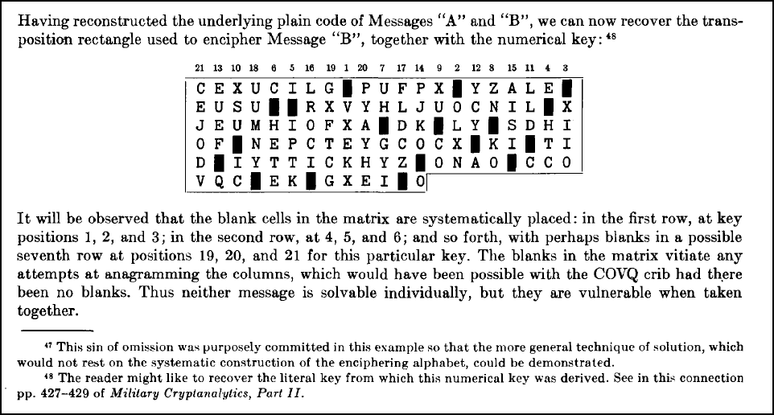
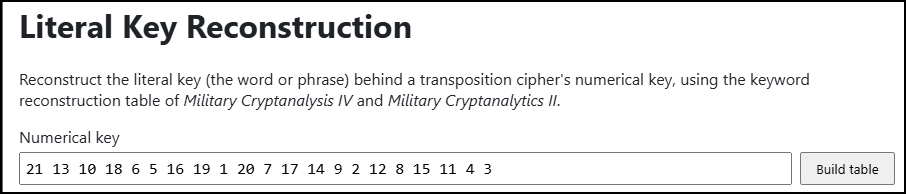
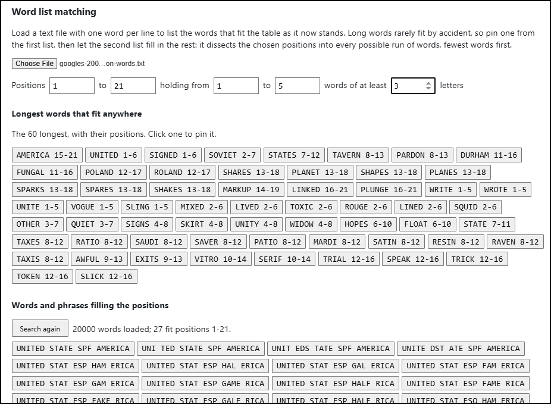
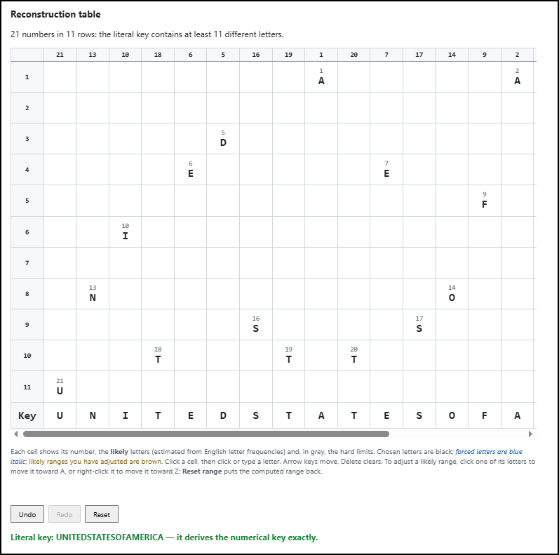

[&larr; back to the guide](literal-key-reconstruction-guide.html#examples)

## The numerical key

Our example is taken from Military Cryptanalytics, part III, page 307:

\

Although the example brought is a transposition matrix with blanks within, we are 
interested in the numerical key on top of the matrix:

```
21 13 10 18 6 5 16 19 1 20 7 17 14 9 2 12 8 15 11 4 3
```

As we saw in [Example 1](example-1-matching-one-word-key.html), here is our plan:

* Given the length of the numerical key, we assume the liternal key in multi-word.
* Using a word list, we'll search for a multi-word key that matches our numerical key.
* If we don't find the literal key, we can select one or both of the following:
    * Search again with a larger word list.

## Step by step

First, enter the numerical key into the text box and click "Build table":

\

Scroll down to use word matching to discover the literal key, specifying Google's 20,000 common word list.  Now let's decide the parameters for matching words to the numberical key.  The numerical key has 21 values, so a single word is less probablr.  Let's widen our net and assume the following:

* There can be from one to five words
* The minimum number of letters per word can be three (3).

Here is the word list matching filter:

\

By this time, the results should be in:

\

Looking in the section titled "Words and phrases filling the positions", the first match is familiar to us:

\

By now we can guess the correct literal key: "UNITEST STATES OF AMERICA".  The reason our word matching did not find the correct literal key was our setting "words of at least" to three (3), while the correct key has the two-letter word "OF".  We make two changes to the filter:

* Knowing the answer has four words, fixing the count at 4 removes the noise that a minimum of 2 would otherwise bring.
* Changing the "words of at least" setting to two (2) to acommodate two-letter words (e.g., "OF").

This results in:

\

The matcher found other solution such as `UNITED STATE SOG AMERICA` and `UNITED STATES OGAM ERICA`.  These fit because their letters fall in the same alphabetical order as the real key. The search can’t tell them apart from the true answer.  We need to use our intelligence to decide which is the correct key.

### Longest words that fit anywhere

Now is a good opportunity to look at the section titled "Longest words that fit anywhere".  The results listed here are long words that match a portion of the numerical key, not necessarily positioned at the beginning of the numerical key.  Thus, we see 60 such words that match different positions.  Had we not solved the literal key, we might have searched for hints within this result list, with "AMERICA", "UNITED", and "STATES" standing out.

### Results: Words and phrases filling the positions

In this section, the matcher found the probable phrase: UNITED STATES OF AMERICA.  Clicking on that word in the results sets up the reconstruction table with the solution:

\

The reconstruction table states clearly "Literal key: UNITESSTATESOFAMERICA — it derives the numerical key exactly". 

## Summary

Because the numerical key was so long, to find the literal key requires a wider net.  This was accomplished by searching for 1-5 words in the literal key.  We set "words of at least" to three (3) to reduce run time and output noise.  The literal key was apparent, even with "words of at least" set to three.  Setting it to two (2) gave us the correct literal key.