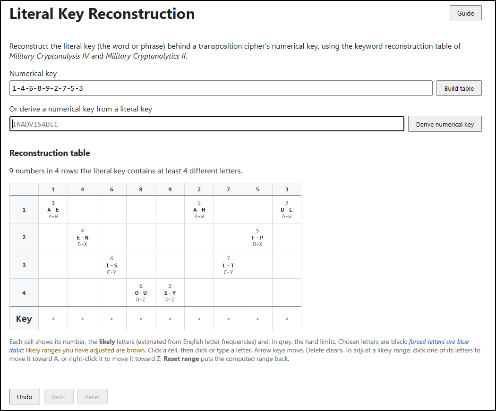
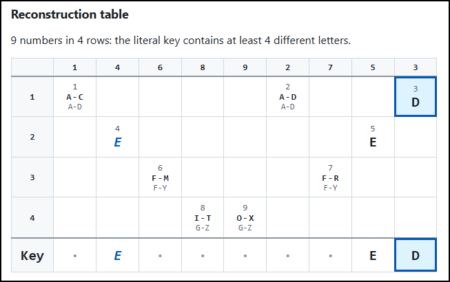
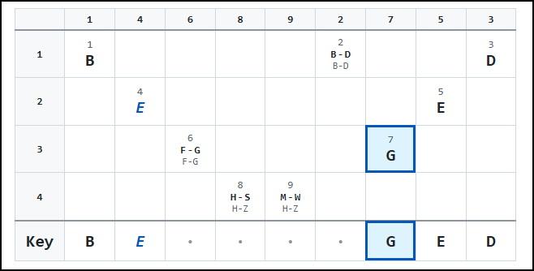
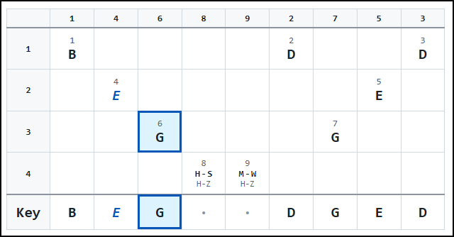

[&larr; back to the guide](literal-key-reconstruction-guide.html#examples)

## The challenge

In this example, we will attempt to <u>manually</u> reconstruct a literal key from a numerical one.  By "manually" we mean not making use of the automated aids such as word list matching.  Manual reconstruction is a much more difficult task, possibly requiring backtracking assumptions made.  Again, keep in mind that there is occasionally more than one literal word that produces the numerical key being analyzed.

## The numerical key

For this example, I requested from AI to extract a random none-letter word from a large word list, to derive its numerical key, and to present it to me without divulging the original literal key -- all done to "keep me honest" when trying to solve it.

Here is the numerical key:

``` {.large}
1-4-6-8-9-2-7-5-3
```

## Step by step

We begin by priming the "Literal Key Reconstruction" tool with the numerical key:

\

Let's look at the word suffix, a vulnerable entry for many numerical keys:

\

Note the ascending diagonal of the cells: they constituted a diagonal from bottom-left to top-right.

::: indented
We will refer to these columns, from left to right, as "column 7", column 5", and column 3", identified by the numerical value at the top of each column.
:::

If you think about it, the letter behind the cell in column 7 must alphabetically follow the letter in column 5, which in turn must follow the letter in column 3.  Examining a list of the 100 most common three-letter suffixes in English, here are the ones whose letters honor the three reconstruction cells:

``` {.large}
TED 1511
LED 661
RED 611
NED 480
SED 337
HED 306
TIC 297
ZED 296 
KED 262 
IED 242 
GED 231 
PED 224 
MED 192 
URE 136 
VED 129
```

Of the 15 suffixes, 13 of them end with "ED".  We will therefore assume the moment that our numerical key ends in "ED":

\

Inserting "E" in column 5 forces an "E" in column 4, and inserting "D" in column 3 modifies the true letter ranges in columns 1 and 2.

Looking at column 1, after inserting "D" in column 3, the true range of letters is now A-D (the bolded A-C is the tools recommended range based on letter frequencies).  Of the three possible letters, "AE" doesn't look promising.  "CE" is certainly possible but no common English word comes to mind.  For now, we'll go with a "B" in column 1:

\

Let's try to complete the three-letter suffix by examining column 7.  The true range is wide at F-Y, while the tool reduces that range to F-R based on letter frequencies.

Trying column 7 as "F" gives us:

\

This forces column 6 to represent an "F", too.  Something doesn't look right with the two Fs, so we undo the assignment by highlighting the "F" and clicking "Clear letter".  Now we assign the next letter "G":

\

In column 2, the only feasible letter in the range B-D is "D":

\

Inserting an "F" in column 6 does not bring any word to mind, but inserting a "G" does:

\

The last remaining row is row 4.  We can assume the letters there occur further down tha alphabet than "H" amd "M".  The word "BEGRUDGED" fits the bill and solves the problem:

\

## Summary

Reconstructing a key manually is naturally more difficult than word list matching.  Nonetheless, there are cases where one is forced to at least partially solve it manually.  These include literal keys with non-dictionary words and English or foreign names or words.

Be sure to read the references in the top page; these give good rules-of-thumb when reconstructing literal keys manually.
