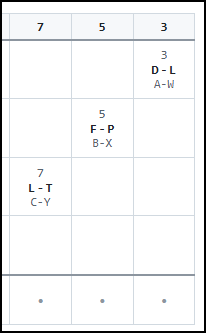
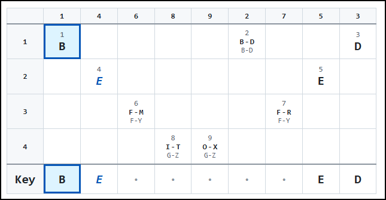
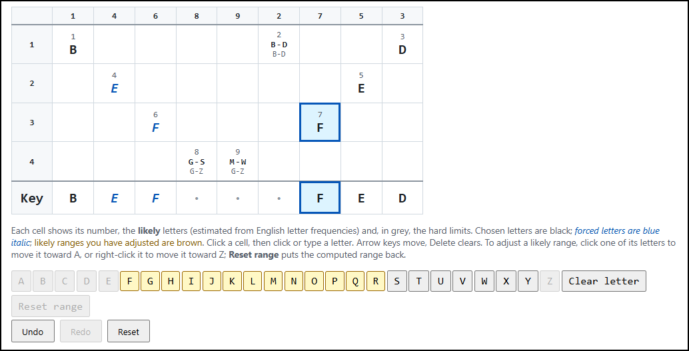
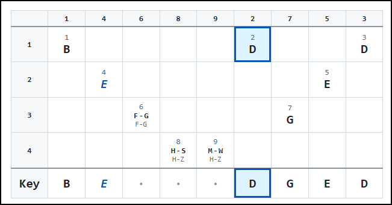
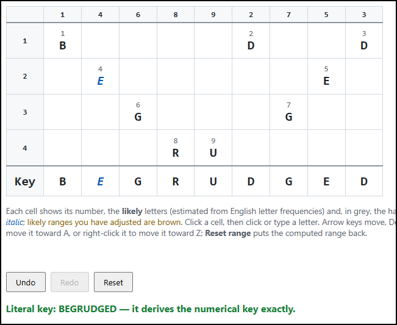

[&larr; back to the guide](literal-key-reconstruction-guide.html#examples)

## The challenge

In this example, we will attempt to *manually* reconstruct a literal key from a numerical one.  By "manually" we mean not making use of the automated aids such as word list matching.  Manual reconstruction is a much more difficult task, sometimes requiring us to undo assumptions.  Again, keep in mind that there is occasionally more than one literal key that produces the numerical key being analyzed.

## The numerical key

For this example, I asked an AI to extract a random nine-letter word from a large word list, to derive its numerical key, and to present it to me without divulging the original literal key -- all done to "keep me honest" when trying to solve it.

Here is the numerical key:

``` {.large}
1-4-6-8-9-2-7-5-3
```

## Step by step

We begin by priming the "Literal Key Reconstruction" tool with the numerical key:

\

Let's look at the word suffix, as word endings are often the easiest place to start:

\

Note that these cells form a diagonal from bottom-left to top-right.

::: indented
We will refer to these columns, from left to right, as "column 7", "column 5", and "column 3", identified by the numerical value at the top of each column.
:::

If you think about it, the letter behind the cell in column 7 must alphabetically follow the letter in column 5, which in turn must follow the letter in column 3.  Column 7's letter can't equal column 5's: equal letters are numbered left to right, and column 7 lies to the left of column 5.  The same logic holds for column 5 versus column 3.

Counting the three-letter endings of the words in [Google's list of the 20,000 most common words](literal-key-reconstruction-guide.html#word-lists), here are those among the 100 most common endings whose letters fall in descending alphabetical order, with the number of words ending in each:

``` {.large}
TED 305
RED 122
TON  92
SED  87
SON  77
TIC  77
NED  76
URE  74
LED  64
ONE  48
IED  46
KED  44
HED  43
GED  41
MED  41
VED  39
```

Of the 16 endings, 11 of them end with "ED".  We will therefore assume for the moment that the literal key ends in "ED":

\

Inserting "E" in column 5 forces an "E" in column 4, and inserting "D" in column 3 modifies the hard limits in columns 1 and 2.

Looking at column 1, after inserting "D" in column 3, the hard limit of letters is now A-D (the bolded A-C is the tool's likely range based on letter frequencies).  Column 4 is the key's second letter, so column 1 gives the opening: AE…, BE…, CE… or DE….  Of the four possible letters, "AE" doesn't look promising.  "CE" is certainly possible but no common English word comes to mind.  For now, we'll go with "BE" (if we reach a dead-end, we'll try "DE"):

\

Let's try to complete the three-letter suffix by examining column 7.  The hard limit is wide at F-Y, while the tool reduces that range to F-R based on letter frequencies.

Trying column 7 as "F" gives us:

\

This forces column 6 to represent an "F", too.  Something doesn't look right with the two Fs: `B E F _ _ _ F E D` suggests no word, so we press Undo, which removes both Fs.  Now we assign the next letter "G":

\

In column 2, "D" is chosen because column 2 is the sixth letter, and `B E _ _ _ D G E D` ends in `-DGED`, as in *judged*, *nudged* and *hedged*:

\

Back to column 6, which can now be F or G.  Inserting an "F" in column 6 does not bring any word to mind, but inserting a "G" does:

\

The last remaining row is row 4, which holds the fourth and fifth letters, both between H and Z, with column 9's after column 8's. `B E G _ _ D G E D` suggests BEGRUDGED, which fits:

\

## Summary

Start from a common ending, test word openings against the likely ranges, and undo when a choice leads nowhere.

Reconstructing a key manually is naturally more difficult than word list matching.  Nonetheless, there are cases where one is forced to at least partially solve it manually.  These include literal keys with non-dictionary words, proper names and foreign words.

Be sure to read the [references](literal-key-reconstruction-guide.html#references) in the guide; these give good rules-of-thumb when reconstructing literal keys manually.
