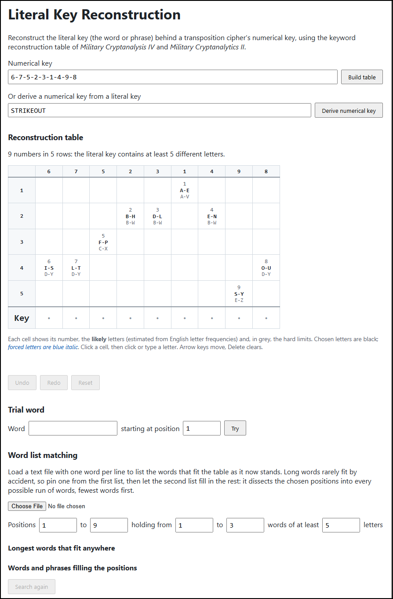

[&larr; back to Literal Key Reconstruction](literal-key-reconstruction.html)

## What is this tool used for?

A **literal key** is a key made of letters: a word, a phrase or a sentence.
A **numerical key** is a sequence of numbers. One produced from a literal key
is called a **derived numerical key**.

The usual method numbers the letters of the literal key in alphabetical order:
the letter earliest in the alphabet gets 1, the next gets 2, and so on. A letter
that occurs more than once is numbered from left to right.

For example, in the key word LOGISTICS, C comes first in the alphabet, so it
gets 1; G gets 2; the two I's get 3 and 4, from left to right; and so on:

| L | O | G | I | S | T | I | C | S |
|:-:|:-:|:-:|:-:|:-:|:-:|:-:|:-:|:-:|
| 5 | 6 | 2 | 3 | 7 | 9 | 4 | 1 | 8 |

(After Callimahos, *Military Cryptanalytics*, part I, par. 38.)

Moving in the opposite direction, i.e., reconstructing the literal key given the 
derived numerical key, is a more difficult challenge.

This tool helps a cryptanalyst reconstruct an original literal key from its numerical key.

::: indented
<b>NOTE:</b>: A given numerical key can map to more than one possible and valid literal key.  For example, the numerical key "1-9-2-6-7-3-4-8-5", can be derived by numerous literal keys, including "AVAILABLE", "BUCKTEETH", and even "DUET TESTS".  A cryptanalyst should use common sense and collateral information to decide on the most probable literal key.

As this note implies, literal keys can consist of one or more words.
:::

## Screen shot

The following is a partially loaded initial screen:

\

The screenshot shows the numerical key "6-7-5-2-3-1-4-9-8" derived from the literal key "STRIKEOUT".  The tool has created a "literal key reconstruction table" to aid in manually reconstructing the literal key.

The tool has other useful sections, including the "Trial word" and "Word list matching" aids.

The following section describes each of these aids.

## The different tool aids

As mentioned in the previous section, the Literal Key Reconstruction tool offers different aids to simplify the task of reconstructing the original literal key.  Let's examine each part of the tool.

### Numerical key

The whole point of the tool is to convert a numerical key to a literal one.
Therefore, you must provide a numerical key in this text box.

Type the numbers in key order and press **Build table**. Separate the numbers
with dashes, spaces or commas: `6-9-1-4-11-7-10-2-3-8-5`, `6 9 1 4 11 7 10 2 3 8 5`
and `6,9,1,4,11,7,10,2,3,8,5` are all read the same way.

A key of length *n* must use each number from 1 to *n* exactly once. If it
doesn't, the tool says which numbers are missing and builds nothing.

**Build table** always starts over: it builds a new reconstruction table, clears
any letters you have placed, and starts a new word-list search.

Example: You solved a transposition cipher that uses the numerical key "9-1-11-6-5-10-2-12-7-4-3-8".  You should type this into the Numerical Key text field.

### Derive a numerical key from a literal key

This aid works in the opposite direction: type a literal key, a word or a
phrase, and press **Derive numerical key**. The tool numbers its letters as
described above, puts the result in the **Numerical key** box, and builds the
reconstruction table, just as **Build table** would.

Only letters count. Upper and lower case are treated the same, and spaces,
punctuation and digits are ignored, so `Duet tests` and `DUETTESTS` derive
the same key.

This is useful for practice: derive the key of a word you know, then try to
reconstruct the word from the table. It also shows what the table looks like
for a known answer.

### Reconstruction table

This aid is based on the keyword reconstruction table described by Friedman
(*Military Cryptanalysis IV*) and Callimahos (*Military Cryptanalytics II*).

::: indented
<b>NOTE</b>: Before using this aid, be sure to use the "word list matching" aid found below.
If the matching fails to find the literal key, you can always come back to the
reconstruction table aid for manual analysis.
:::

**How the table is built.** The numerical key runs across the top. Each number
sits in a row of its own choosing: while the next higher number lies to the
*right*, it stays in the same row; when it lies to the *left*, it drops to a
new row. Letters never decrease from one number to the next, and a new row
means the letter *must* increase. So the number of rows is the fewest
different letters the literal key can have. The line above the table states
this, for example *9 numbers in 5 rows: the literal key contains at least 5
different letters.*

**Reading a cell.** Each cell shows:

* its number;
* the **likely** range, for example `J-L`, estimated from English letter
  frequencies;
* in grey, the **hard limits**: the only letters the cell can possibly hold.

The bottom row, **Key**, spells out the literal key as far as it is known.

**Placing letters.** Click a cell, then click a letter in the picker below the
table or type it. Letters outside the cell's limits are greyed out, and the
letters in the likely range are highlighted. **Clear letter** removes the
cell's letter. Every letter you place narrows the limits of the other cells;
when a cell is left with only one possible letter, the tool fills it in for
you, in *blue italic*.

**Adjusting a likely range.** The estimate is only a guide. If you think a
cell's letter lies elsewhere, move its likely range one letter at a time:

* **click** a letter of the range to move it one letter toward A;
* **right-click** it to move it one letter toward Z.

For example, three right-clicks on the start of `J-L` give `K-L`, then `L`,
and a right-click on the single `L` widens it to `L-M`. A move that would take
the range outside the hard limits, or put its start after its end, is ignored.
An adjusted range is shown in brown and applies to that cell only. To go back
to the estimate, select the cell and press **Reset range** in the picker.

**Keyboard.** The left and right arrow keys move along the key, Delete or
Backspace clears a cell, and Escape deselects it.

**Undo, Redo and Reset** step back, step forward, or start the table afresh.
Undo and Redo cover adjusted ranges as well as letters; Reset clears every
placed letter and every adjusted range.

When every cell is filled, the tool reports whether the resulting literal key
derives the numerical key exactly.

### Trial word

When you suspect a word belongs somewhere in the literal key, try it here.
Type the word, enter the key position where it starts (1 is the leftmost
number of the key), and press **Try**.

If the word fits, its letters are placed in the table in one step, and the
limits of every other cell narrow just as if you had placed them by hand.
Letters already in those cells are replaced. **Undo** takes the whole word
back.

If the word cannot fit, nothing changes and the tool says where the
alphabetical order breaks, for example: *ACT does not fit: the alphabetical
order breaks at position 5.* A word that runs past the end of the key is
rejected too.

A good strategy is to try a likely word, see how much of the key it settles,
and undo it if the rest of the table leads nowhere.

### Word list matching {#word-lists}

This aid searches a word list for words that fit the table. Load a plain-text
file with one word per line (case doesn't matter; lines with anything other
than letters are skipped).

To specify a word list, you will need to download such a file that contains 
a significant number of words (you can use this tool to reconstruct keys in 
any Latin character language (e.g., English, French, German).  Searching the
Internet will find such lists.  Here are links to English lists you may want
to download and use:

* [Google 20,000 most common English words](https://raw.githubusercontent.com/first20hours/google-10000-english/master/20k.txt)
  (20,000 words). Few obscure words, so the matches are short and readable.
* [Google 10,000 most common US English words](https://raw.githubusercontent.com/first20hours/google-10000-english/master/google-10000-english-usa.txt)
  (10,000 words). Even shorter; good for a first pass.
* [John Burkardt's word list](https://people.sc.fsu.edu/~jburkardt/datasets/words/wordlist.txt)
  (300,260 words). A large general list.
* [dwyl English words, letters only](https://raw.githubusercontent.com/dwyl/english-words/master/words_alpha.txt)
  (about 370,000 words). Very complete, but full of rare words that fit by
  accident.
* [12dicts by Alan Beale](https://downloads.sourceforge.net/wordlist/12dicts-6.0.2.zip)
  (a zip of several carefully checked lists of common words; unzip it and load
  one of the `.txt` files).

Start with a small list of common words; switch to a large one only if nothing
sensible turns up.

The tool shows two dynamic lists generated while searching proceeds.

**Longest words that fit anywhere** shows up to 60 words that fit somewhere in
the key, longest first, each with the positions it would occupy, for example
`PAPERWORK 6-14`. A long word rarely fits by accident, so it is a strong clue.
Click a word to place it in the table.

**Words and phrases filling the positions** fills a stretch of the key
completely with one or more words, using these settings:

* **Positions … to …**: the stretch of the key to fill. It starts out as the
  whole key.
* **holding from … to … words**: how many words the phrase may contain.
* **words of at least … letters**: the shortest word allowed. Raising it cuts
  down on short-word noise.

Phrases with the fewest words are listed first, and the search stops after
300 matches; the line beside **Search again** says when it has. Press **Show 600
more** to carry on from where it stopped, as often as you like. To keep the
page responsive, each press replaces the phrases on screen with the next 600,
headed by the range they cover, for example *Showing matches 301-900*. A long search runs in the background: a progress bar shows how
far it has got, and **Stop** halts it. Click a phrase to place it in the table.

Every letter you place, by any means, restarts both lists, so they always
reflect the table as it now stands. The best way to work is to pin a long word
from the first list, then let the second list fill in the rest.

## Examples

* [Matching a one-word literal key](example-1-matching-one-word-key.html)
* [Matching a multi-word literal key](example-2-matching-multi-word-key.html)
* [Manually solving a one-word literal key](example-3-manually-solving-one-word-key.html)

## References

The following are valuable references in the open cryptanalytic literature that deal with manually reconstructing a literal key given a numerical one.

* Callimahos, Lambros D., and William F. Friedman. *Military Cryptanalytics,
  Part II*. Washington, DC: National Security Agency, February 1958. Sec. 3, pp. 500–502.
  [PDF](docum/Keyword-Recovery.Military-Cryptanalytics-II-section-3.pp.500-502.pdf){.pdf-button target="_blank"}
* Dr. Cryptogram [E. L. Newman]. *The Cryptogram* 16, no. 3 (June–July 1947):
  44–45.
  [PDF](docum/Numerical-Keyword-Recovery.The-Cryptogram.JJ1947.pdf){.pdf-button target="_blank"}
* Friedman, William F. *Military Cryptanalysis, Part IV: Transposition and
  Fractionating Systems*. Washington, DC: Government Printing Office, 1941.
  Pp. 15–17.
  [PDF](docum/Keyword-Recovery.Military-Cryptanalysis-IV.pp.15-17.pdf){.pdf-button target="_blank"}
* Gaines, Helen Fouché. *Elementary Cryptanalysis: A Study of Ciphers and Their
  Solution*. Boston: American Photographic Publishing, 1939. Pp. 64–65.
  Reprinted as *Cryptanalysis: A Study of Ciphers and Their Solution*. New York:
  Dover, 1956.
  [PDF](docum/Elementary-Cryptanalysis.Keyword-Recovery.pp-64-65.pdf){.pdf-button target="_blank"}